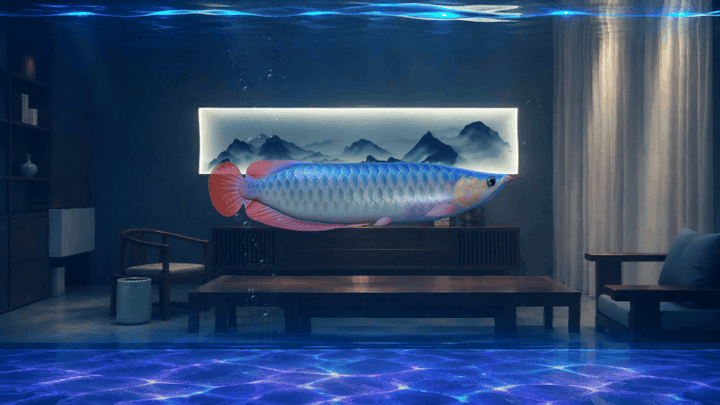

# RealWorldBuilder



实时 3D 展厅。可以观赏一条龙鱼和六条不同花色的孔雀鱼共游，也可以单独看鱼或打开碎花垂耳兔的 3D 预览。

[打开 GitHub Pages](https://bestyize.github.io/RealWorldBuilder/)

打开 [index.html](index.html) 浏览展厅，或直接打开 [aquarium.html](aquarium.html) 离线观赏。从展厅进入水族箱时，默认使用「山水客厅」，显示龙鱼和孔雀鱼同缸，砂石水草处于关闭状态。直接打开水族箱会恢复这个浏览器上次的选择。点击右上角「设置」可切换单条龙鱼、单条孔雀鱼、孔雀鱼群或同缸，也可以独立开关砂石水草造景。

「鱼类观察」的三个预览打开即铺满视窗。用鼠标或手指拖动画面可旋转视角，点击「重置视角」可回到正面。手机竖持时，画面和控件会一起旋转到横向。点击「全屏」可在浏览器支持时收起地址栏并锁定横屏。水族箱在触屏设备上也可点击「全屏」切到横向布局。

「背景」页可以切换六套预设，或选择本机的 JPG、PNG、WebP 图片。「灯光」页可以调节水族箱的灯光和反射。按 D、B 或 L 可以直接打开对应页面。

在「背景」里选「透明」，可以在透明底上显示当前选中的鱼和造景。点击「打开龙鱼透明播放页」可进入 `aquarium.html#overlay`，单独叠加龙鱼，保留鳍和轮廓的透明度。

把播放页用作 OBS 浏览器源时，可在仓库目录运行 `python3 -m http.server 8000 --bind 127.0.0.1`，再填入 `http://127.0.0.1:8000/aquarium.html#overlay`。嵌入网页时，把 iframe 放到画面图层上方。

```html
<iframe
  title="龙鱼"
  src="./aquarium.html#overlay"
  style="position: absolute; inset: 0; width: 100%; height: 100%; border: 0; color-scheme: light; pointer-events: none;"
></iframe>
```

预设以山水客厅为初始背景。自定义图按原比例居中裁切成 16∶9，画面最长边保留至 2560 像素。浏览器允许本地存储时，同一地址重新打开会恢复所选背景和最近一张自定义图。

每个鱼种在各自目录维护 Blender 工程、GLB 和游动代码。可以分别打开[龙鱼](fish/arowana/preview.html)、[单条蓝扇尾孔雀鱼](fish/blue-guppy/preview.html)和[六条孔雀鱼群](fish/blue-guppy/school-preview.html)的独立预览。[碎花垂耳兔](objects/plush-rabbit/preview.html)可以拖动旋转和缩放。

展厅使用 `index.html`、`src/gallery.css` 和 `assets/gallery/` 中的素材。修改预览源码或模型后，用 Node.js 20.9 或更新版本运行 `npm ci` 和 `npm run build`。构建会将模型贴图和预设背景转换为 WebP，并内嵌到可离线打开的 HTML 中。PNG 贴图使用无损编码并保留透明度，JPEG 背景和底色贴图使用高质量编码。Blender 工程及原始素材仍是编辑和导出的来源。

## 背景素材

原山水客厅使用 `assets/aquarium.jpg`。另外三张用内置 ImageGen 生成，生成提示词如下。

<details>
<summary>雨林黑水 · assets/blackwater.jpg</summary>

Photorealistic 16:9 background plate for an aquarium. An Asian blackwater river viewed from under the surface, as a wildlife documentary still. Dark amber water, an old submerged piece of dark driftwood and a few roots on the far left, sparse fallen brown leaves on the sandy bed at the bottom, soft tea-colored shafts of sun from the upper left. Keep central and right midwater spacious and relatively dark, with subtle suspended texture and warm depth. Natural amber and umber, little saturation, true underwater optics. Landscape 16:9 fixed eye-level documentary camera, natural realistic textures, clean screen-filling composition with calm uncluttered midtones across the middle and extra detail along the outer edges. This will be the background plate behind a moving bright silver-blue Asian arowana with coral fins. Leave room for the fish. Absolutely no fish, animal, person, lettering, visible aquarium frame, text, watermark or UI.

</details>

<details>
<summary>清绿水草 · assets/aquascape.jpg</summary>

Photorealistic 16:9 background plate of a planted freshwater aquarium in the style of a refined Japanese nature aquarium. The aquascape has tall emerald aquatic leaves and fine grasses framing the left and right, a few slate stones and moss low at the edges, and a pale gravel path receding into a spacious midwater opening. Soft daylight from above, clear warm green water with subtle natural light falloff, fine leaf detail, measured contrast, quiet editorial photography. Keep the middle of the frame softly receding so a long blue and red fish can swim past. Landscape 16:9 fixed eye-level documentary camera, natural realistic textures, clean screen-filling composition with calm uncluttered midtones across the middle and extra detail along the outer edges. This will be the background plate behind a moving bright silver-blue Asian arowana with coral fins. Leave room for the fish. Absolutely no fish, animal, person, lettering, visible aquarium frame, text, watermark or UI.

</details>

<details>
<summary>月下湖景 · assets/moon-window.jpg</summary>

Photorealistic 16:9 atmospheric architecture photograph for a transparent aquarium backdrop. At blue hour, view from a quiet contemporary Japanese room toward a broad dark wood framed picture window. Across the window beyond are a still lake, low mist, a layered blue-gray mountain ridge, and a small soft pale moon high on the right. A single subtle amber lantern low at the left edge provides a warm point, with spare wood sill and calm clean horizontal lines. Keep the central area dark blue, calm and open, avoiding any very bright feature behind the moving fish. Luxurious natural film photography, never stylized. Landscape 16:9 fixed eye-level documentary camera, natural realistic textures, clean screen-filling composition with calm uncluttered midtones across the middle and extra detail along the outer edges. This will be the background plate behind a moving bright silver-blue Asian arowana with coral fins. Leave room for the fish. Absolutely no fish, animal, person, lettering, visible aquarium frame, text, watermark or UI.

</details>
